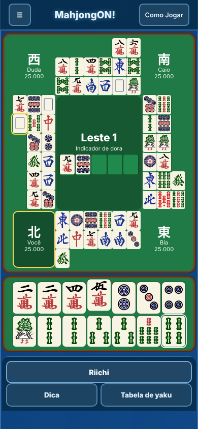
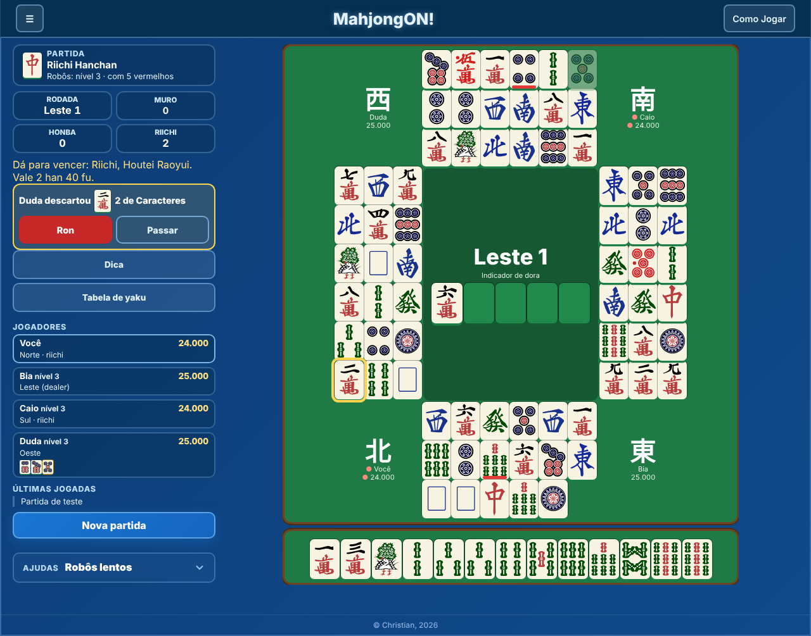

# MahjongON!

Mahjong japonês (**Riichi**) para quatro jogadores, no navegador: você joga contra **três robôs**, com as **peças originais** desenhadas em SVG, regras de partida online, dicas e uma ajuda completa para quem nunca jogou. Funciona no navegador ou instalado como app, inclusive sem internet.

**Jogue:** https://mahjongon.netlify.app/ · **Mais jogos:** https://speccygames.netlify.app/

  
  &nbsp;&nbsp;
  

## Como jogar

1. Toque no botão da partida, no alto da tela, e escolha a **duração** (Hanchan ou Tonpuusen), se quer os **5 vermelhos** e o **nível** dos robôs. Depois toque em **Jogar**.
2. Cada um recebe 13 peças. Na sua vez, compre uma peça e descarte outra: **toque numa peça para escolhê-la** e toque de novo para descartar.
3. Monte **quatro grupos e um par** (sequências e trios). Ao ficar a uma peça de ganhar, você pode declarar **Riichi**.
4. Quando alguém descartar uma peça que serve para você, aparece a **barra de chamadas**: **Ron** (vencer), **Pon**, **Chi**, **Kan** ou **Passar**.
5. Vence a mão quem completar um grupo de peças com pelo menos um **yaku** (uma combinação que vale pontos). A partida termina ao fim das rodadas escolhidas, e o jogo mostra a colocação e a pontuação final.

O botão **Como Jogar** do topo explica o site, as regras, todos os yaku (com exemplos desenhados), a tabela de pontos e traz dicas de estratégia. Na primeira visita ele abre sozinho.

## Regras

O jogo segue as regras mais usadas nas partidas online de Riichi:

- 136 peças, com três **5 vermelhos** (aka dora) opcionais
- **Hanchan** (rodadas do Leste e do Sul) ou **Tonpuusen** (só o Leste), com 25.000 pontos para cada um e rodada extra quando ninguém chega a 30.000
- Riichi, ippatsu, dora, ura dora e dora de kan; **kuitan** (tanyao aberto) e atozuke
- Chi, pon e kan (aberto, fechado e acrescentado), com a prioridade correta entre as chamadas
- **Ron duplo**, furiten (de descarte, temporário e de riichi) e **pao**
- Todos os yaku de uso comum, de 1 han até os **yakuman** (com yakuman duplo), mais o **kazoe yakuman** (13 han ou mais) e o pagamento do honba
- Nagashi mangan e as mãos canceladas (nove pontas, quatro ventos, quatro riichis, quatro kans, três rons)
- Pontuação final com uma e oka

## As peças

Os desenhos são os das peças tradicionais de Riichi, com os símbolos e a arte originais: Caracteres (萬), Pontos (筒) e Bambus (索), os quatro ventos (東南西北) e os três dragões (白發中), mais os 5 vermelhos. Cada peça é um SVG, então o desenho continua nítido em qualquer tamanho, do celular ao monitor grande.

## Os robôs

Cinco níveis: o 1 Iniciante joga quase ao acaso, o 2 Casual monta mãos simples, o 3 Intermediário escolhe bem o que descartar e declara riichi, o 4 Avançado conta as peças que já saíram e lê o riichi dos outros, e o 5 Expert defende com método e só ataca quando vale a pena. Dá para misturar níveis com a opção **Variados**. Os robôs só usam o que um jogador de verdade sabe: nunca olham a mão de ninguém.

## Recursos

- Mesa com os descartes de cada jogador em volta do centro, o último descarte marcado e a peça do riichi com uma faixa vermelha
- Mão em uma ou duas fileiras, conforme o tamanho da tela, com **dois toques** para descartar (sem descartar sem querer)
- **Esperas na hora:** ao escolher uma peça, o jogo mostra por quais peças você espera e quantas ainda restam, ou quantas trocas faltam para ficar pronto
- Barra de chamadas com a peça em destaque e cada jeito de fazer pon ou chi desenhado no botão
- Aviso quando um robô descarta a sua espera e você não pode dar ron (**furiten** ou mão sem yaku), e confirmação antes de passar um ron que valeria
- **Dica** que sugere a jogada e explica o motivo (partidas com dica não entram nas estatísticas)
- Tela de resultado com a mão vencedora, os yaku, han, fu e quanto cada um pagou, e a tabela de yaku a um toque (ou na tecla **Y** no computador)
- Velocidade dos robôs à sua escolha e descarte automático depois do riichi
- Sorteio das peças feito com uma semente complexa e diferente a cada partida
- Partida salva automaticamente: feche a aba e continue depois
- Menu lateral com atalho **Outros Jogos**, **estatísticas** (partidas, colocações, mãos vencidas, riichis, yakuman e maior mão) e **configurações** (som, vibração, modo escuro, reduzir animações)
- No computador e com o celular deitado, os controles ficam numa coluna e a mesa fica sempre à vista
- Modo escuro e "reduzir animações" (seguem o sistema por padrão)
- Instala no celular ou no computador e funciona offline

O jogo não tem partida online pela internet: você joga contra os robôs.

## Instalando como app

- **Chrome e Edge (computador e Android):** botão **Instalar app** no menu ☰ ou o ícone na barra de endereço.
- **Safari (iPhone e iPad):** Compartilhar, depois *Adicionar à Tela de Início*.

## Créditos

Os desenhos das peças são do projeto **riichi-mahjong-tiles**, de FluffyStuff, em domínio público (CC0 1.0). Fonte: https://github.com/FluffyStuff/riichi-mahjong-tiles. Os arquivos foram otimizados com o SVGO e reunidos num único arquivo de peças.

Os ícones usam a fonte DejaVu Sans Bold, que parte da Bitstream Vera (© 2003 Bitstream, Inc., licença que permite uso gratuito, inclusive comercial; as mudanças do DejaVu são de domínio público). Fonte: https://dejavu-fonts.github.io/.

## Família ON!

MahjongON! segue a base visual do **DiciON!**. Todos os jogos ficam em https://speccygames.netlify.app/.

---

Feito por Christian ([@Christian5910](https://github.com/Christian5910)).
